# Assignment 2

## 1. Program organisation:
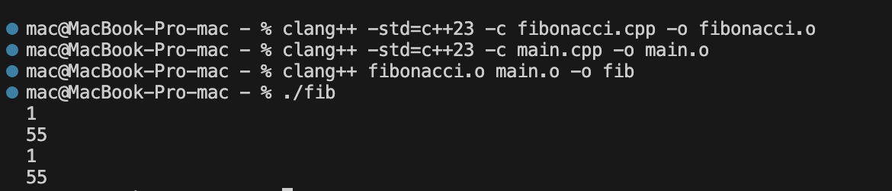

## 2. Stages exploration:
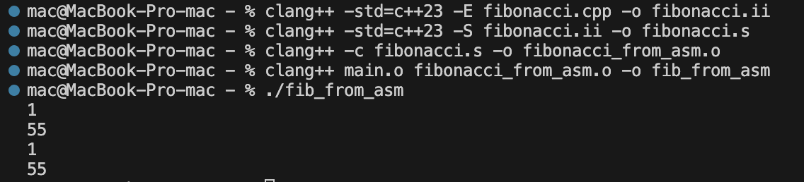

## 3. Explanation:
### 1. What do the .ii, .s, object, and executable files contain? Which are text files, which are binary files, and which build stage produces each one?
- `.ii` file is in text format, it's the code after preprocessing: all `#include`s are changed to a "lower" perspective, mentioning files and rows from which the actual inclusion is happening. The program won't compile at this stage, compiler doesn't understand it yet. We need to go deeper and put this code into Assembly code, which brings us to `.s` file.
- `.s` file is still readable, it is written in assembly. Still not ready for a run, but is closer to how the computer reads the instructions.
- `.o` file - object file in binary format, which contains machine code + a table of symbols, but still not ready for a run.
- executable file - link stage, where all of this data in `.o` files gets sewn together and determines the actual addresses. Executable file is in binary format.

### 2. Why can main.cpp compile when it sees a function declaration but not the function body? Why does linking still need the definition?
Compiler only needs to know the name of the function, the parameters(quantity + type) and what does the function get in and return. The linker need the definition to understand what does he need to do with those parameters and what does this function do exactly, since executable file cannot have those gaps, that object file has - all needs to be assembled in one. The linker needs to know the actual address cell in memory for this function, because a simple reference to the function is not executable.

### 3. What does the include guard prevent? If both .cpp files include the same header, does the guard stop the second source file from seeing its contents?
It prevents the duplicate insertion of headers. It would not prevent the second file from seeing the contents, since the files compile separately, but it would cause a compile-time error because of duplicate definition.

### 4. Which object files must be rebuilt after changing only a function body in fibonacci.cpp? What changes if you edit a declaration in the shared header?
Since the change appeared only in `fibonacci.cpp`, we don't need to rebuild `main.o`, but `fibonacci.o` needs to be. `main.cpp` doesn't care about the definition, since it simply redirects the data to this function. But if a shared header (in our case it's `fibonacci.hpp`) is changed, of course we need to recompile both `main.o` and `fibonacci.o`, since both translation units depended on header's contents.

## 4. Errors exploration:
### 1. Missing declaration:
The missing information here is the declaration, because of this the compiler does not know where to look to find those functions, since this header `fibonacci.hpp` is the only binding factor for both `main.cpp` and `fibonacci.cpp`, they can't exchange info without the `.hpp` file. This causes compile-time error.

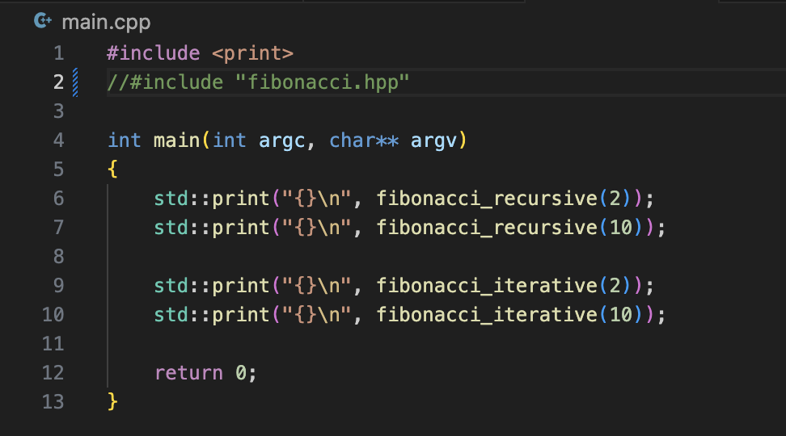
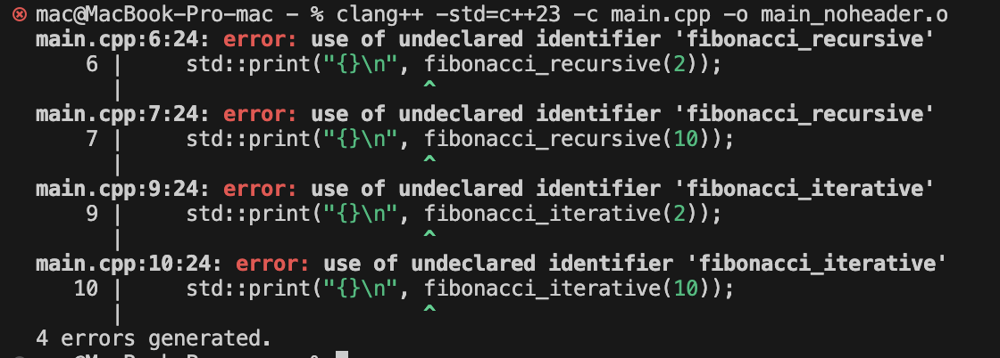

### 2. Missing definition:
The linker is left with only the declarations with the gap in definitions, since we didn't include fibonacci.o to the linking stage, so it cannot resolve the symbols and refuses to produce the executable file.
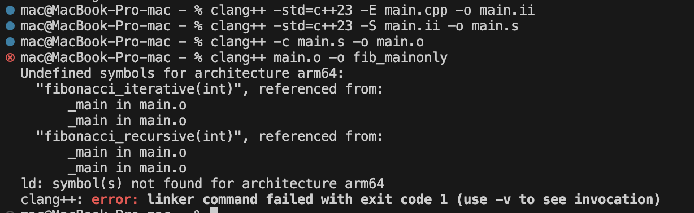

# Assignment 3

## 1. Why adding a directory does not replace linking a target
`add_subdirectory(dir)` only tells CMake to also process `dir/CMakeLists.txt` and register the targets it defines in the same project. After that, `fibonacci_lib` and `fibonacci_app` simply both *exist* in the build graph - there is still no relationship between them. CMake does not guess that the app uses the library just because they are in the same project.

That relationship is created only by `target_link_libraries(fibonacci_app PRIVATE fibonacci_lib)`. It (1) puts the library on the app's link line, so the linker can resolve `fibonacci_recursive`/`fibonacci_iterative` (without it we would get the same "undefined symbols" link error as in Assignment 2's missing-definition experiment), (2) makes the library build before the app, and (3) propagates the library's PUBLIC usage requirements, such as its include directory, to the app. In short, `add_subdirectory` decides *which targets exist*, linking decides *who depends on whom*.

## 2. C++23 without language extensions
The app is linked to the library by target name: `target_link_libraries(fibonacci_app PRIVATE fibonacci_lib)`. `target_compile_features(<target> PRIVATE cxx_std_23)` tells CMake the target needs at least C++23. By default CMake then passes `-std=gnu++23`, for example, C++23 **plus** GNU compiler extensions. To get pure standard C++ we set the target property `CXX_EXTENSIONS` to `OFF`.

```cmake
set_target_properties(<target> PROPERTIES CXX_EXTENSIONS OFF)
```

## 3. Header search path
The library declares its include directory as a PUBLIC requirement:

```cmake
target_include_directories(fibonacci_lib PUBLIC include)
```

The application has no include setting of its own, it gets `-I.../libraries/fibonacci/include` only because it links to `fibonacci_lib`, which forwards its PUBLIC requirements to whoever links it.

### Why the include path is PUBLIC, but sources and language are PRIVATE
- **PRIVATE** = needed only to build this target. **PUBLIC** = needed to build this target and by anyone who uses it.
- **Include path - PUBLIC.** `fibonacci.hpp` is the library's interface. `fibonacci.cpp` needs it to compile the library, and `main.cpp` needs it to call the functions. So the path is needed on both sides.
- **Sources - PRIVATE.** `fibonacci.cpp` is compiled once into `libfibonacci_lib.a`. The app uses the finished compiled code through linking. If the source were PUBLIC, it would be compiled into the app too and the functions would be defined twice.
- **Language (`cxx_std_23`, no extensions) - PRIVATE.** It controls how this target's `.cpp` files are compiled. The header uses only plain `int` functions, so users of the library don't need C++23. Each target states its own standard, the app sets C++23 in its own `CMakeLists.txt`.

## 4. Debug and Release builds
Each configuration gets its own build directory under `build/`. 
```bash
cmake -S source -B build/debug -G Ninja -DCMAKE_CXX_COMPILER=clang++ -DCMAKE_BUILD_TYPE=Debug
./build/debug/application/fibonacci_app

cmake -S source -B build/release -G Ninja -DCMAKE_CXX_COMPILER=clang++ -DCMAKE_BUILD_TYPE=Release
./build/release/application/fibonacci_app
```

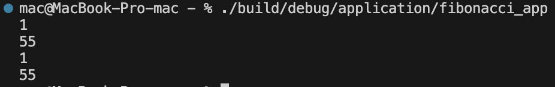
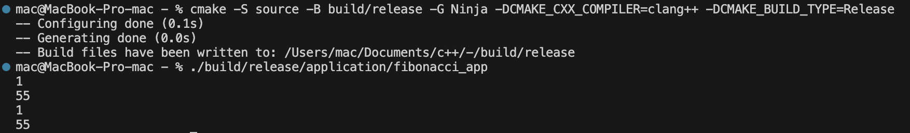

## 5. Diagnosing a missing requirement
In `source/libraries/fibonacci/CMakeLists.txt` I temporarily changed

```cmake
target_include_directories(fibonacci_lib PUBLIC include)
```
to `PRIVATE` and rebuilt Debug with `cmake --build build/debug`:

```
mac@MacBook-Pro-mac - % cmake --build build/debug
[0/1] Re-running CMake...
-- Configuring done (0.1s)
-- Generating done (0.0s)
-- Build files have been written to: /Users/mac/Documents/c++/-/build/debug
[1/3] Building CXX object application/CMakeFiles/fibonacci_app.dir/src/main.cpp.o
FAILED: [code=1] application/CMakeFiles/fibonacci_app.dir/src/main.cpp.o 
/opt/homebrew/opt/llvm@19/bin/clang++   -g -std=c++23 -arch arm64 -MD -MT application/CMakeFiles/fibonacci_app.dir/src/main.cpp.o -MF application/CMakeFiles/fibonacci_app.dir/src/main.cpp.o.d -o application/CMakeFiles/fibonacci_app.dir/src/main.cpp.o -c /Users/mac/Documents/c++/-/source/application/src/main.cpp
/Users/mac/Documents/c++/-/source/application/src/main.cpp:2:10: fatal error: 'fibonacci.hpp' file not found
    2 | #include "fibonacci.hpp"
      |          ^~~~~~~~~~~~~~~
1 error generated.
ninja: build stopped: subcommand failed.
```

### Failing stage
CMake's **configure and generate** steps still succeed, to CMake this is a valid project, it just has fewer requirements. The failure is at compile time, in the preprocessing part of compiling `main.cpp`: the preprocessor cannot find the file named in `#include`, we never reach linking.
Only the app fails: `fibonacci.cpp` was not even rebuilt, because its compile command did not change.

### Why the library still has its include path, but the app does not
**PRIVATE** means "use this only to build the target itself". The `-I` flag stays on `fibonacci_lib`'s own compile commands, so `fibonacci.cpp` still finds its header. `target_link_libraries(fibonacci_app PRIVATE fibonacci_lib)` passes on only the library's **PUBLIC** requirements. There is no longer a public include path, so the app gets nothing and `main.cpp` is compiled with no `-I` flag at all.

### Fix
Restored `PUBLIC`, rebuilt and ran:

```
mac@MacBook-Pro-mac - % cmake --build build/debug       
[0/1] Re-running CMake...
-- Configuring done (0.1s)
-- Generating done (0.0s)
-- Build files have been written to: /Users/mac/Documents/c++/-/build/debug
[2/3] Linking CXX executable application/fibonacci_app
mac@MacBook-Pro-mac - % ./build/debug/application/fibonacci_app                                                          
1
55
1
55
```

# Assignment 4
## 2. Elevator app run result:
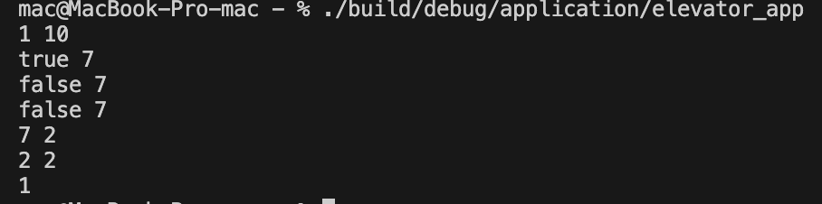

## 3. Access and const experiments:
### 1. `lift.current_floor_ = 5;` right after declaring `lift`

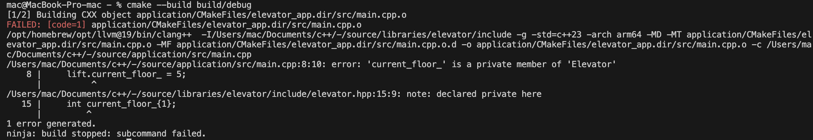

`current_floor_` is declared in the `private:` section, and private members can only be used by the class's own member functions (and friends). `main` is not a member of `Elevator`, so it may not touch it, since the compiler stops at the access check.

Inside `go_to` the assignment is allowed because `go_to` *is* a member function of `Elevator` (`Elevator::go_to`), so it has access to all of the class's private data. Access control is per class, not per object: code that belongs to the class can use the private parts, outside code has to go through the public functions.

### 2. `fixed.go_to(2);` after the final print

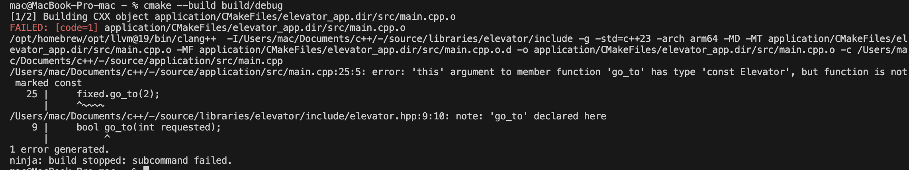

The trailing `const` in `int current_floor() const;` is a promise, that the function does not change the object. Because of that promise, it can be called on a `const Elevator` like `fixed` - that is why `fixed.current_floor()` compiles. `go_to` has no such `const`, so the compiler refuses to call it on a const object.

The same declaration would be wrong for `go_to`, because the whole job of `go_to` is to change the object: it assigns `current_floor_ = requested`. Inside a `const` function the members are read-only, so that assignment would not compile.

### 3. `Elevator spare;` right after declaring `lift`

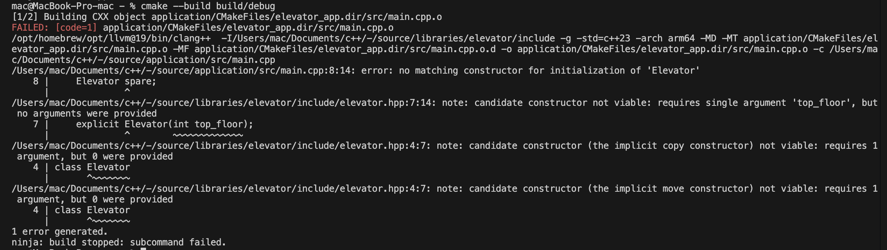

The compiler only generates an implicit default constructor for a class that declares **no constructors at all**. `Elevator` declares `Elevator(int top_floor)`, so that automatic default constructor is not generated. The only candidates left are our one-argument constructor and the implicit copy/move constructors, and none of them can be called with zero arguments.

The default member initializers `{1}` do not change this. They are not a constructor - they only say what value a member gets when some constructor runs and does not set that member itself (that is how `current_floor_` becomes 1 in our constructor). Without a constructor that takes no arguments, they are never used for `spare`. The class is left without a default constructor on purpose: an elevator has to be told its top floor.

## 4. Construction and destruction order:
### 1. Prediction (written before building)
```
construct 1
construct 2
inspect 2
destroy 2
destroy 2
destroy 2
construct 11
destroy 11
construct 12
destroy 12
construct 20
construct 21
construct 20
construct 22
end of leave_early
destroy 22
destroy 20
end of main
destroy 1
```

### 2. Actual output
```
mac@MacBook-Pro-mac - % ./build/debug/probe/probe_app
construct 1
construct 2
inspect 2
destroy 2
destroy 2
destroy 2
construct 11
destroy 11
construct 12
destroy 12
construct 20
construct 21
destroy 21
destroy 20
construct 20
construct 22
end of leave_early
destroy 22
destroy 20
end of main
destroy 1
```

### Prediction vs. actual output
19 of 21 lines matched. The only difference is in `leave_early(true)` - two lines that are in the actual output but missing from my prediction, right after `construct 21`:

```
destroy 21    <- missing in my prediction
destroy 20    <- missing in my prediction
```

**What I thought, and why it turned out to be wrong:** when I made the prediction, I already knew that objects are destroyed when their scope ends, in reverse order and that `copy` and the `probe` parameter of `inspect` are separate copies of `two`. They don't print `construct` because they are made by the copy constructor, not by `Probe(int id)`. So I expected three `destroy 2` lines and a separate `construct`/`destroy` pair for every loop iteration and this part matched the real output.

My mistake was in `leave_early(true)`. I thought that `return` immediately jumps out of the function, so the closing `}` of the `if` block and of the function are never reached. Since I connected destruction with "reaching the `}`", I expected `second` and `first` to never be destroyed, and wrote no `destroy` lines for that call.

The actual output has `destroy 21` and `destroy 20` right after `construct 21`. This showed me that destruction is not tied to physically reaching the brace, but to leaving the scope in any way - by reaching the end, by `return`, or by an exception. When `return` runs, C++ still destroys every local object that was already constructed, in reverse order: first `second` (21), then `first` (20). `return` only skips the statements after it - here `Probe third{22};` and `std::println("end of leave_early");` - which is why there is no `construct 22` and no `end of leave_early` for the first call.

### 3. Explanation of every destroy line
- `destroy 2` (1st) - `probe`, the parameter of `inspect`. It is destroyed when `inspect(copy)` returns, before the next statement runs.
- `destroy 2` (2nd) - `copy`. It is destroyed at the `}` of the inner block in `main`, before `two`, because it was created after it.
- `destroy 2` (3rd) - `two`. It is destroyed at the same `}` of the inner block.
- `destroy 11` - `item` from the 1st loop iteration (`i = 1`). It is destroyed at the `}` of the loop body, at the end of that iteration.
- `destroy 12` - `item` from the 2nd loop iteration (`i = 2`). It is destroyed at the `}` of the loop body, at the end of that iteration.
- `destroy 21` - `second` in `leave_early(true)`. It is destroyed because `return` left the `if` block.
- `destroy 20` - `first` in `leave_early(true)`. It is destroyed because the same `return` left the function.
- `destroy 22` - `third` in `leave_early(false)`. It is destroyed at the closing `}` of `leave_early`, first, because it was created last.
- `destroy 20` - `first` in `leave_early(false)`. It is destroyed at the same closing `}`.
- `destroy 1` - `one`. It is destroyed when `return 0;` leaves `main`, after `end of main` was printed.

#### Why `construct 2` appears once, but `destroy 2` three times
There are three different `Probe` objects with id 2, but only one of them is made by `explicit Probe(int id)`, which is the only constructor that prints:
1. `two` - `Probe two{2};` calls `Probe(int)` and prints `construct 2`.
2. `copy` - `Probe copy = two;` is a **copy construction**. It uses the implicit copy constructor that the compiler generated for `Probe`. That constructor just copies `id_` and prints nothing.
3. `probe` - `inspect(copy)` takes its parameter **by value**, so calling it copy-constructs a new `Probe` from `copy`, again with the silent implicit copy constructor.

All three are real objects, so each gets its own destructor call - and the destructor is the one we wrote, so each of them prints `destroy 2`. This is why the numbers of `construct` and `destroy` lines don't match.

#### Why the loop constructs and destroys on every iteration
The body `{ Probe item{10 + i}; }` is its own block scope, and that scope is entered and left again on **each** iteration. So `item` is a fresh object every time: it is created when the declaration runs (`construct 11`), and destroyed when the iteration reaches the end of the body (`destroy 11`), before `++i` and the next check. On the next iteration a new `item` is made with `10 + 2` (`construct 12` / `destroy 12`). Two objects never exist at the same time.

#### What `return` skips in `leave_early(true)`
- **Skipped statements:** `Probe third{22};` and `std::println("end of leave_early");` - they come after the `return`, so they never run. `third` is never created, which is why there is no `construct 22` or `destroy 22` for this call.
- **Still destroyed:** every object that was already constructed when `return` ran - `second` (21) and then `first` (20), in reverse order of creation.

## 5. Explanation:
### 1. `Elevator service = lift;` vs `lift = service;`
`Elevator service = lift;` creates a new object, `service`, and initializes it from `lift`, so it uses the copy constructor. `lift = service;` creates nothing: `lift` already exists and its values are overwritten with the ones from `service`, so it uses the copy assignment operator. Both are available because the compiler generates them implicitly when a class does not declare its own. They copy the members one by one (`current_floor_` and `top_floor_`), which is exactly what `Elevator` needs.

### 2. Rejecting a bad top floor in the constructor
A constructor has no return value, so it cannot return `false` like `go_to`. When the constructor finishes, the object exists and is used as valid. The usual way is to throw an exception, for example `throw std::invalid_argument{"top floor must be at least 1"};` if `top_floor < 1`. Then the object is never created, and the caller can catch the error instead of getting a broken elevator.

### 3. Is `private` enough for the invariant?
No. `private` only stops code outside the class from changing `current_floor_`. The member functions can still break the rule, so the invariant is kept by how they are written:
- `current_floor_{1}` - the elevator starts at floor 1.
- `if (requested < 1 || requested > top_floor_) return false;` - invalid floors are rejected first.
- `current_floor_ = requested;` - only runs after the check passed.

If `go_to` assigned first and checked later, `go_to(12)` would leave the elevator on floor 12 of a 10-floor building, even though it returns `false`. Also, the constructor does not check `top_floor`, so `Elevator{0}` already breaks the invariant.

### 4. Is `Elevator` destroyed without a destructor?
Yes. When its scope ends, the compiler-generated destructor runs, just like for `Probe`. `Elevator` only holds two `int`s and owns no resources, so there is nothing to clean up. A hand-written `~Elevator()` would add nothing useful here - it would only make sense for printing a trace like `Probe` does, or for a class that has to release something (memory, a file, a lock).
